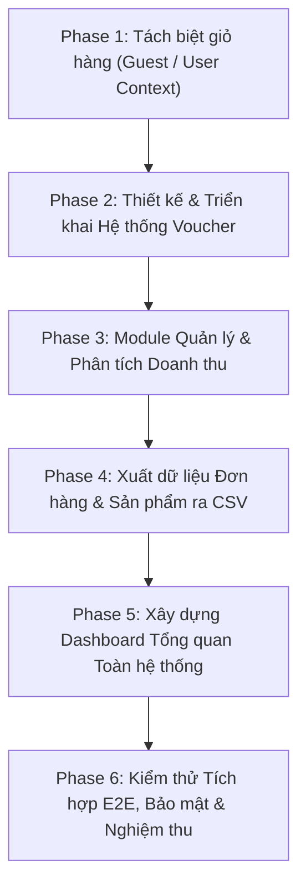

# KẾ HOẠCH TRIỂN KHAI CHI TIẾT (IMPLEMENTATION PLAN)

## DỰ ÁN: FUNNYSHOP (FULL-STACK)
**Tài liệu:** Kế hoạch nâng cấp & bổ sung tính năng nghiệp vụ nâng cao  
**Vị trí chi tiết trong docs:** [PLAN_NEW_FEATURES.md](file:///d:/thuc_tap/Thuc_Tap_Ki_IV/docs/PLAN_NEW_FEATURES.md)  
**Phạm vi:** Backend (Spring Boot 3, JPA, MySQL) & Frontend (React, Vite, Zustand, Tailwind CSS)  
**Các tính năng triển khai:**
1. **Lưu giỏ hàng tách biệt theo tài khoản / khách (Guest vs User Cart Isolation)**
2. **Hệ thống Voucher: Quản lý Voucher (Admin) & Áp dụng Voucher (Customer)**
3. **Quản lý Doanh thu & Phân tích Tài chính (Revenue Management)**
4. **Xuất dữ liệu Đơn hàng & Sản phẩm ra định dạng CSV (CSV Export)**
5. **Dashboard tổng quan toàn hệ thống (Admin System Overview Dashboard)**

---

## I. TỔNG QUAN TIẾN ĐỘ & PHÂN KỲ GIAI ĐOẠN



| Giai đoạn | Nội dung chính | Trọng tâm công nghệ | Mức độ ưu tiên | Trạng thái |
|---|---|---|---|---|
| **Phase 1** | Tách biệt giỏ hàng theo tài khoản / khách; xử lý dọn dẹp khi đăng xuất | Frontend Zustand Store, LocalStorage Partitioning, Session Context | 🔴 P0 (Cao nhất - Sửa lỗi bảo mật/UX) | `[x] Đã hoàn thành` |
| **Phase 2** | Quản lý & Áp dụng Voucher (DB, Service, Validation, Checkout Lock, UI) | MySQL Schema, Spring JPA, Pessimistic Locking, Checkout API, React Modal | 🔴 P0 (Nghiệp vụ cốt lõi) | `[x] Đã hoàn thành` |
| **Phase 3** | Quản lý & Phân tích Doanh thu (Aggregations, Period Filter, Timeline API) | SQL Aggregation, Time-series Query, Spring Service, Admin UI | 🟡 P1 (Nghiệp vụ quản trị) | `[x] Đã tích hợp sẵn (Dashboard Analytics)` |
| **Phase 4** | Xuất dữ liệu Đơn hàng & Sản phẩm ra CSV chuẩn UTF-8 BOM | Spring Streaming CSV, OpenCSV / Writer, Blob Download Client | 🟡 P1 (Tiện ích vận hành) | `[ ] Đang triển khai` |
| **Phase 5** | Xây dựng Dashboard tổng quan toàn hệ thống cho Admin | Recharts / Chart.js, StatCards, Realtime Recent Orders, KPI Summary | 🟢 P2 (Trải nghiệm quản trị) | `[ ] Chưa làm` |
| **Phase 6** | Kiểm thử tích hợp E2E, Kiểm tra tải & concurrency, Tối ưu & Bàn giao | JUnit 5, Integration Test, Postman / Playwright, Data Verification | 🟢 P2 (Đảm bảo chất lượng) | `[ ] Chưa làm` |

---

## II. CHI TIẾT KỸ THUẬT TỪNG GIAI ĐOẠN

### --------------------------------------------------------------------------------
### 🔹 GIAI ĐOẠN 1: TÁCH BIỆT GIỎ HÀNG THEO TÀI KHOẢN / KHÁCH
*(Guest vs User Cart Isolation & Cleanup on Logout)*

#### 1. Hiện trạng & Vấn đề cần giải quyết
- File `frontend/src/store/cartStore.js` đang cấu hình `persist` tĩnh với `name: 'funnyshop_cart'`.
- Khi User A đăng xuất, key `funnyshop_cart` vẫn còn nguyên trong `localStorage`. Khi User B hoặc một khách khác vào trình duyệt, toàn bộ mặt hàng của User A vẫn hiển thị và có thể thanh toán nhầm.
- Cần có cơ chế cô lập không gian lưu trữ cho từng User ID và Guest.

#### 2. Thiết kế Kỹ thuật (Frontend Store)
- **Cơ chế Partitioning Key trong `localStorage`:**
  - Khách vãng lai: `funnyshop_cart_guest`
  - Người dùng đăng nhập: `funnyshop_cart_user_{userId}`
- **Luồng xử lý trạng thái (State Transition Logic):**
  1. **Khi khởi tạo ứng dụng:**
     - Đọc thông tin `user` từ `authStore`.
     - Nếu đã đăng nhập (`user.id` tồn tại) $\rightarrow$ nạp dữ liệu từ `funnyshop_cart_user_{user.id}`.
     - Nếu chưa đăng nhập $\rightarrow$ nạp dữ liệu từ `funnyshop_cart_guest`.
  2. **Khi Khách Đăng nhập (Login Event):**
     - Đọc giỏ hàng khách hiện tại từ `funnyshop_cart_guest`.
     - Đọc giỏ hàng tài khoản `funnyshop_cart_user_{user.id}`.
     - Thực hiện **Merge Giỏ hàng**: Nếu cùng sản phẩm/biến thể thì cộng dồn số lượng (giới hạn tối đa bởi `stockQuantity`).
     - Lưu giỏ hợp nhất vào `funnyshop_cart_user_{user.id}`.
     - Xóa rỗng `funnyshop_cart_guest`.
  3. **Khi Người dùng Đăng xuất (Logout Event):**
     - Lưu trạng thái cuối của user vào `funnyshop_cart_user_{user.id}`.
     - Reset `items: []` trong bộ nhớ state hiện hành.
     - Nạp lại giỏ hàng rỗng (hoặc giỏ hàng khách mới) từ `funnyshop_cart_guest`.
     - Đảm bảo màn hình Cart lập tức render danh sách trống, không còn dấu vết của tài khoản cũ.

#### 3. Danh sách công việc triển khai
- [ ] Tái cấu trúc `frontend/src/store/cartStore.js`:
  - Loại bỏ persist tĩnh một key đơn lẻ, xây dựng storage helper dynamic theo `activeCartKey`.
  - Bổ sung action `initUserCart(userId)`.
  - Bổ sung action `handleLogoutCart()`.
  - Bổ sung action `mergeGuestCartIntoUser(userId)`.
- [ ] Cập nhật `frontend/src/store/authStore.js`:
  - Hook gọi `useCartStore.getState().initUserCart(user.id)` trong hàm `login()`.
  - Hook gọi `useCartStore.getState().handleLogoutCart()` trong hàm `logout()`.
- [ ] Kiểm thử thủ công & viết kịch bản test trên trình duyệt.

---

### --------------------------------------------------------------------------------
### 🔹 GIAI ĐOẠN 2: HỆ THỐNG VOUCHER (QUẢN LÝ & ÁP DỤNG MÃ GIẢM GIÁ)
*(Voucher Management & Safe Checkout Application)*  
**Tài liệu chi tiết:** [PLAN_PHASE_2_VOUCHER_SYSTEM.md](file:///d:/thuc_tap/Thuc_Tap_Ki_IV/docs/PLAN_PHASE_2_VOUCHER_SYSTEM.md)

#### 1. Thiết kế Cơ sở dữ liệu (Database Schema)
Bổ sung bảng `vouchers` và `voucher_usages`, cập nhật bảng `orders`:

```sql
-- 1. Bảng quản lý Voucher
CREATE TABLE IF NOT EXISTS vouchers (
    id BIGINT AUTO_INCREMENT PRIMARY KEY,
    code VARCHAR(50) NOT NULL UNIQUE,
    title VARCHAR(255) NOT NULL,
    description TEXT,
    discount_type VARCHAR(20) NOT NULL, -- 'PERCENTAGE' hoặc 'FIXED_AMOUNT'
    discount_value DECIMAL(12,2) NOT NULL, -- Giá trị % hoặc số tiền VND
    max_discount_amount DECIMAL(12,2) NULL, -- Giảm tối đa nếu là PERCENTAGE
    min_order_value DECIMAL(12,2) NOT NULL DEFAULT 0.00, -- Đơn hàng tối thiểu
    usage_limit INT NOT NULL DEFAULT 1, -- Tổng số lượt dùng tối đa
    used_count INT NOT NULL DEFAULT 0, -- Số lượt đã sử dụng thực tế
    per_user_limit INT NOT NULL DEFAULT 1, -- Giới hạn số lần dùng / 1 tài khoản
    start_date DATETIME NOT NULL,
    end_date DATETIME NOT NULL,
    is_active BOOLEAN NOT NULL DEFAULT TRUE,
    created_at TIMESTAMP DEFAULT CURRENT_TIMESTAMP,
    updated_at TIMESTAMP DEFAULT CURRENT_TIMESTAMP ON UPDATE CURRENT_TIMESTAMP,
    INDEX idx_voucher_code_active (code, is_active, start_date, end_date)
) ENGINE=InnoDB DEFAULT CHARSET=utf8mb4 COLLATE=utf8mb4_unicode_ci;

-- 2. Bảng lưu vết lịch sử sử dụng voucher của từng User
CREATE TABLE IF NOT EXISTS voucher_usages (
    id BIGINT AUTO_INCREMENT PRIMARY KEY,
    voucher_id BIGINT NOT NULL,
    user_id BIGINT NOT NULL,
    order_id BIGINT NOT NULL,
    discount_amount DECIMAL(12,2) NOT NULL,
    used_at TIMESTAMP DEFAULT CURRENT_TIMESTAMP,
    FOREIGN KEY (voucher_id) REFERENCES vouchers(id),
    FOREIGN KEY (user_id) REFERENCES users(id),
    FOREIGN KEY (order_id) REFERENCES orders(id),
    INDEX idx_usage_voucher_user (voucher_id, user_id)
) ENGINE=InnoDB DEFAULT CHARSET=utf8mb4 COLLATE=utf8mb4_unicode_ci;

-- 3. Cập nhật bảng orders để lưu vết chiết khấu
ALTER TABLE orders 
    ADD COLUMN voucher_id BIGINT NULL AFTER payment_method,
    ADD COLUMN voucher_code VARCHAR(50) NULL AFTER voucher_id,
    ADD COLUMN subtotal_amount DECIMAL(12,2) NOT NULL DEFAULT 0.00 AFTER phone,
    ADD COLUMN discount_amount DECIMAL(12,2) NOT NULL DEFAULT 0.00 AFTER subtotal_amount,
    ADD CONSTRAINT fk_orders_voucher FOREIGN KEY (voucher_id) REFERENCES vouchers(id);
```

#### 2. Thiết kế Backend (Spring Boot)
- **Entities & Enums:**
  - `Voucher.java` (`@Entity`, mapping quan hệ, `Pessimistic Locking` khi trừ `usedCount`).
  - `VoucherUsage.java` (`@Entity`).
  - `DiscountType.java` (`PERCENTAGE`, `FIXED_AMOUNT`).
- **DTOs:**
  - `VoucherCreateRequest`, `VoucherUpdateRequest`: Validation ngày kết thúc > ngày bắt đầu, mức giảm hợp lệ.
  - `VoucherResponse`: Dữ liệu trả về cho client/admin.
  - `VoucherApplyRequest` (`code`, `items` hoặc `subtotal`).
  - `VoucherApplyResponse` (`valid`, `discountAmount`, `finalAmount`, `message`).
- **API Endpoints:**
  - `GET /api/vouchers/available`: Lấy danh sách voucher công khai còn hiệu lực.
  - `POST /api/vouchers/apply`: Validate mã và tính trước tiền giảm cho giỏ hàng.
  - `GET /api/admin/vouchers`: Danh sách quản lý voucher (phân trang, lọc theo code, status).
  - `POST /api/admin/vouchers`: Tạo mới voucher.
  - `PUT /api/admin/vouchers/{id}`: Chỉnh sửa voucher.
  - `PATCH /api/admin/vouchers/{id}/toggle`: Kích hoạt / Tạm dừng voucher.
  - `DELETE /api/admin/vouchers/{id}`: Xóa mềm voucher chưa phát sinh đơn.
- **Xử lý An toàn tại Order Checkout (`OrderServiceImpl`):**
  - Khi khách gửi `OrderCheckoutRequest` có kèm `voucherCode`:
    1. Truy vấn voucher kèm khóa hàng: `@Lock(LockModeType.PESSIMISTIC_WRITE)`.
    2. Kiểm tra điều kiện: `is_active == true`, `now() BETWEEN start_date AND end_date`, `used_count < usage_limit`, `subtotal >= min_order_value`.
    3. Đếm số lần user đã dùng mã trong `voucher_usages` $\le$ `per_user_limit`.
    4. Tính toán chính xác `discount_amount` tại Backend (tuyệt đối không nhận `discount_amount` do Frontend gửi lên).
    5. Lưu đơn hàng với `total_amount = subtotal - discount_amount`.
    6. Tăng `used_count = used_count + 1` và tạo bản ghi trong `voucher_usages`.

#### 3. Thiết kế Frontend (React)
- **Quản lý Voucher cho Admin (`AdminVouchers.jsx`):**
  - Route: `/admin/vouchers`.
  - Bảng danh sách: Mã, Tiêu đề, Loại giảm giá, Giá trị, Lượt dùng (`used/total`), Thời hạn, Trạng thái (Badge).
  - Modal tạo/sửa voucher trực quan, hỗ trợ chọn ngày bằng DatePicker.
- **Áp dụng Voucher tại Storefront (`Cart.jsx` & `Checkout.jsx`):**
  - Ô nhập input mã voucher kèm nút "Áp dụng".
  - Nút "Chọn voucher": Mở popup hiển thị danh sách các mã đang có, kèm điều kiện đơn hàng tối thiểu.
  - Hiển thị badge voucher đã áp dụng kèm nút "Hủy mã" (`x`).
  - Cập nhật dòng chiết khấu trong phần tổng quan đơn hàng:
    - Tạm tính: `500.000 đ`
    - Voucher giảm giá: `-50.000 đ`
    - **Tổng thanh toán: 450.000 đ**

---

### --------------------------------------------------------------------------------
### 🔹 GIAI ĐOẠN 3: QUẢN LÝ DOANH THU & HỆ THỐNG BÁO CÁO
*(Revenue Management & Financial Analytics)*

#### 1. Logic nghiệp vụ & Công thức tính toán
- **Doanh thu thực tế (Net Revenue):** Chỉ tính từ các đơn hàng có trạng thái `DELIVERED` (hoặc `COMPLETED`).
- **Doanh thu tiềm năng (Pending Revenue):** Tổng giá trị các đơn ở trạng thái `PENDING`, `CONFIRMED`, `SHIPPING`.
- **Doanh thu thất thoát (Cancelled Revenue):** Tổng giá trị các đơn bị `CANCELLED`.
- **Giá trị trung bình đơn hàng (AOV - Average Order Value):** $\text{AOV} = \frac{\text{Doanh thu thực tế}}{\text{Số đơn thành công}}$.
- **Tổng tiền khuyến mãi đã tài trợ:** `SUM(discount_amount)` của các đơn thành công.

#### 2. Thiết kế Backend (Spring Boot)
- **Repository Queries (`OrderRepository.java`):**
  - Truy vấn tổng doanh thu theo khoảng thời gian:
    ```sql
    SELECT COALESCE(SUM(o.totalAmount), 0) FROM Order o 
    WHERE o.status = 'DELIVERED' AND o.createdAt BETWEEN :startDate AND :endDate
    ```
  - Truy vấn thống kê theo ngày (Time-series Aggregation):
    ```sql
    SELECT DATE(o.createdAt) as reportDate, COUNT(o.id) as totalOrders, SUM(o.totalAmount) as totalRevenue 
    FROM Order o WHERE o.status = 'DELIVERED' AND o.createdAt BETWEEN :startDate AND :endDate 
    GROUP BY DATE(o.createdAt) ORDER BY reportDate ASC
    ```
- **API Endpoints:**
  - `GET /api/admin/revenue/overview`:
    - Params: `startDate`, `endDate`, `period` (`today`, `yesterday`, `7days`, `30days`, `this_month`).
    - Trả về: Tổng doanh thu, % tăng trưởng so với kỳ trước, số lượng đơn hoàn thành, AOV, tổng voucher giảm.
  - `GET /api/admin/revenue/timeline`: Mảng dữ liệu phục vụ vẽ biểu đồ biến động theo ngày/tuần/tháng.
  - `GET /api/admin/revenue/by-category`: Phân bổ doanh số theo danh mục hàng hóa.

#### 3. Thiết kế Frontend (`AdminRevenue.jsx`)
- Route: `/admin/revenue` (kèm icon menu trong `SidebarAdmin.jsx`).
- Bộ lọc thời gian linh hoạt (Hôm nay, 7 ngày qua, Tháng này, Khoảng ngày tùy chọn).
- Các khối thẻ StatCards đo lường doanh thu, so sánh kỳ trước (+X.X%).
- Bảng kê chi tiết doanh thu theo từng ngày (Ngày, Số đơn hoàn tất, Số đơn hủy, Doanh thu gộp, Tiền giảm voucher, Doanh thu thuần).

---

### --------------------------------------------------------------------------------
### 🔹 GIAI ĐOẠN 4: XUẤT DỮ LIỆU ĐƠN HÀNG VÀ SẢN PHẨM RA CSV - [x] Đã hoàn thành
*(Data Export to CSV with UTF-8 BOM)*  
**Tài liệu chi tiết:** [PLAN_PHASE_4_CSV_EXPORT.md](file:///d:/thuc_tap/Thuc_Tap_Ki_IV/docs/PLAN_PHASE_4_CSV_EXPORT.md)

#### 1. Quy chuẩn Kỹ thuật
- **Đảm bảo không lỗi font tiếng Việt trong Excel:** Bắt buộc ghi ký tự Byte Order Mark (BOM `\uFEFF`) ở đầu file CSV trước khi ghi dữ liệu.
- **Escape ký tự đặc biệt:** Xử lý chuỗi chứa dấu phẩy (`,`), dấu nháy kép (`"`), và ký tự xuống dòng (`\n`).

#### 2. Backend Implementation (Spring Boot)
- **Utility:** `CsvExportUtil.java` hỗ trợ định dạng cột, escape chuỗi, ghi header.
- **API Xuất Đơn hàng (`GET /api/admin/orders/export/csv`):**
  - Params: `status`, `startDate`, `endDate`, `search`.
  - Cột xuất:
    1. `Mã đơn hàng`
    2. `Ngày đặt` (Định dạng: `yyyy-MM-dd HH:mm:ss`)
    3. `Tên khách hàng`
    4. `Số điện thoại`
    5. `Địa chỉ nhận hàng`
    6. `Phương thức thanh toán`
    7. `Trạng thái đơn hàng`
    8. `Tiền hàng tạm tính (VNĐ)`
    9. `Mã Voucher`
    10. `Số tiền giảm giá (VNĐ)`
    11. `Tổng tiền thanh toán (VNĐ)`
- **API Xuất Sản phẩm (`GET /api/admin/products/export/csv`):**
  - Params: `categoryId`, `status`.
  - Cột xuất:
    1. `ID Sản phẩm`
    2. `Tên sản phẩm`
    3. `Danh mục`
    4. `Giá niêm yết (VNĐ)`
    5. `Mã SKU biến thể`
    6. `Màu sắc`
    7. `Kích cỡ`
    8. `Tồn kho`
    9. `Trạng thái kinh doanh`

#### 3. Frontend Implementation
- Thêm nút bấm **"Xuất CSV"** (Icon `Download`) trên thanh công cụ của:
  - Trang quản lý đơn hàng: `AdminOrders.jsx`.
  - Trang quản lý sản phẩm: `AdminProducts.jsx`.
- Khi người dùng click:
  - Gửi request kèm token và bộ lọc tìm kiếm hiện tại.
  - Nhận kiểu dữ liệu `blob` (`responseType: 'blob'`).
  - Kích hoạt tải file tự động với tên file chuẩn: `don_hang_funnyshop_YYYYMMDD_HHmm.csv`.

---

### --------------------------------------------------------------------------------
### 🔹 GIAI ĐOẠN 5: DASHBOARD TỔNG QUAN TOÀN HỆ THỐNG
*(Admin System Overview Dashboard)*

#### 1. Thiết kế Giao diện & Bố cục Trang (`AdminDashboard.jsx`)
- **Route:** `/admin/dashboard` và route mặc định `/admin` sẽ redirect về `/admin/dashboard` (thay vì `/admin/products` như hiện tại).

```
+-------------------------------------------------------------------------+
| [Top KPI Cards]:                                                        |
| [ Doanh thu tháng ]  [ Đơn hàng mới ]  [ Khách hàng mới ] [ Cảnh báo kho]|
+-------------------------------------------------------------------------+
| [Chart Doanh thu 14-30 ngày]           | [Chart Phân bố Trạng thái Đơn] |
| (Line/Bar Chart - Recharts)            | (Donut Chart - Recharts)       |
+-------------------------------------------------------------------------+
| [Đơn hàng mới nhất cần xử lý]         | [Top 5 Sản phẩm bán chạy nhất] |
| (Mã đơn, Tên khách, Tổng tiền, Duyệt) | (Tên SP, Đã bán, Tồn kho còn)  |
+-------------------------------------------------------------------------+
```

#### 2. Backend APIs (`AdminDashboardController.java`)
- `GET /api/admin/dashboard/kpi`: Trả về 4 chỉ số chính + tỷ lệ tăng trưởng.
- `GET /api/admin/dashboard/charts`:
  - Dữ liệu biểu đồ doanh thu theo ngày.
  - Phân bổ trạng thái: Chờ xử lý, Đang giao, Đã giao, Đã hủy.
- `GET /api/admin/dashboard/recent-orders`: Top 5-10 đơn hàng gần nhất.
- `GET /api/admin/dashboard/top-products`: Top 5 sản phẩm có số lượng bán cao nhất.
- `GET /api/admin/dashboard/low-stock`: Danh sách sản phẩm có tồn kho $\le 5$.

#### 3. Frontend Implementation
- Cài đặt thư viện vẽ biểu đồ: `recharts` (gọn nhẹ, tương thích tốt với Tailwind CSS & React 18+).
- Xây dựng component `frontend/src/pages/admin/AdminDashboard.jsx`.
- Cập nhật menu Admin:
  - Bổ sung mục "Tổng quan" (Icon `LayoutDashboard`) làm mục đầu tiên trong `SidebarAdmin.jsx`.
  - Sửa `App.jsx`: Route `/admin` chuyển hướng tới `AdminDashboard`.

---

### --------------------------------------------------------------------------------
### 🔹 GIAI ĐOẠN 6: KIỂM THỬ TOÀN DIỆN, BẢO MẬT & NGHIỆM THU
*(Testing, Security, Concurrency & Acceptance Criteria)*

#### 1. Ma trận Kịch bản Kiểm thử (Test Cases)

| Nhóm tính năng | Mã kịch bản | Mô tả kịch bản | Kết quả mong đợi |
|---|---|---|---|
| **Giỏ hàng** | `TC-CART-01` | Khách vãng lai thêm 2 SP $\rightarrow$ Đăng nhập TK | Giỏ hàng tài khoản nhận đủ 2 SP đã thêm, giỏ khách được dọn sạch. |
| **Giỏ hàng** | `TC-CART-02` | TK A có 3 SP $\rightarrow$ Đăng xuất $\rightarrow$ Vào trang Cart | Giỏ hàng trống hoàn toàn; không xuất hiện sản phẩm của TK A. |
| **Giỏ hàng** | `TC-CART-03` | Đăng nhập TK B sau khi TK A đăng xuất | Giỏ hàng chỉ hiển thị đúng các SP của TK B (nếu có trước đó). |
| **Voucher** | `TC-VOU-01` | Nhập mã hợp lệ khi đơn hàng đạt giá trị tối thiểu | Giảm đúng số tiền, tính lại tổng tiền chính xác. |
| **Voucher** | `TC-VOU-02` | Nhập mã đã hết hạn hoặc chưa đạt đơn hàng tối thiểu | Báo lỗi rõ ràng, không cho áp dụng chiết khấu. |
| **Voucher** | `TC-VOU-03` | Concurrency: Mã còn 1 lượt, 2 tài khoản cùng bấm đặt hàng | Chỉ 1 tài khoản đặt thành công với voucher; tài khoản còn lại báo mã đã hết lượt. |
| **Doanh thu** | `TC-REV-01` | Tạo đơn hàng mới (PENDING) $\rightarrow$ Kiểm tra doanh thu | Doanh thu thực tế không tăng (chỉ tăng khi chuyển sang DELIVERED). |
| **Doanh thu** | `TC-REV-02` | Chuyển đơn sang DELIVERED $\rightarrow$ Kiểm tra doanh thu | Doanh thu tăng đúng bằng `total_amount` sau khi đã trừ voucher. |
| **Xuất CSV** | `TC-CSV-01` | Bấm xuất đơn hàng/sản phẩm ra CSV $\rightarrow$ Mở trên Excel | Mở bình thường, font tiếng Việt có dấu hiển thị chuẩn 100%, không bị vỡ cột. |
| **Dashboard** | `TC-DASH-01` | Truy cập `/admin` với quyền ADMIN | Mở đúng trang Dashboard, nạp dữ liệu thống kê mượt mà (< 800ms). |
| **Bảo mật** | `TC-SEC-01` | User thường (CUSTOMER) cố tình gọi API `/api/admin/**` | Backend chặn trả về mã lỗi `403 Forbidden`. |

---

## III. KẾ HOẠCH HÀNH ĐỘNG ĐỀ XUẤT (ACTION ITEMS)

1. **Bước 1:** Triển khai **Giai đoạn 1** (Tách biệt giỏ hàng) để dứt điểm vấn đề trải nghiệm người dùng trên storefront.
2. **Bước 2:** Cập nhật Database Schema (Bảng `vouchers`, `voucher_usages`, bổ sung cột bảng `orders`) $\rightarrow$ Triển khai **Giai đoạn 2** (Hệ thống Voucher).
3. **Bước 3:** Triển khai **Giai đoạn 4** (Xuất CSV cho Sản phẩm và Đơn hàng).
4. **Bước 4:** Xây dựng các Service tổng hợp số liệu cho **Giai đoạn 3** (Quản lý Doanh thu).
5. **Bước 5:** Xây dựng giao diện **Giai đoạn 5** (Dashboard tổng quan cho Admin) kết hợp Recharts.
6. **Bước 6:** Chạy kiểm thử tự động, kiểm tra hồi quy toàn diện hệ thống.

