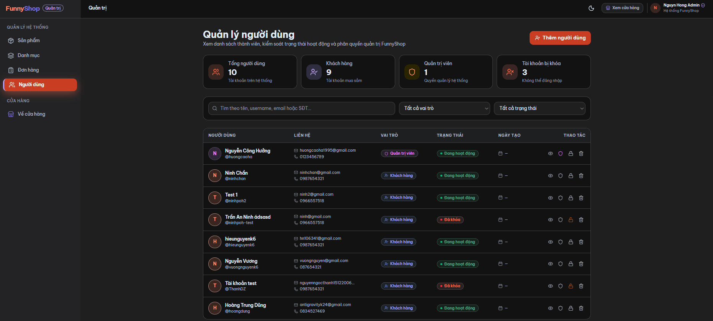

# FunnyShop — Kiểm thử hệ thống qua giao diện

## 1. Mục đích và phạm vi

Tài liệu này dùng để kiểm tra FunnyShop bằng cách thao tác trực tiếp trên website: đăng ký/đăng nhập, mua hàng, hồ sơ, trang quản trị và hiển thị trên nhiều kích thước màn hình. Không cần Postman, gọi API thủ công, truy vấn database hay xem token trong DevTools.

Mục tiêu là ghi nhận những gì người dùng thực sự nhìn thấy và thao tác được. Nếu tính năng không có trên giao diện hoặc không thể xác minh bằng giao diện, ghi `BLOCKED` hoặc `N/A` kèm lý do; không tự suy đoán PASS.

### Những vấn đề đã nhận thấy khi đối chiếu mã nguồn

- Luồng quên/đặt lại mật khẩu ở frontend gửi dữ liệu không khớp với dữ liệu backend yêu cầu; cần kiểm tra trên UI và ghi lỗi nếu không hoàn tất được.
- Các nút AI gọi đến endpoint backend hiện chưa có trong repository; kết quả mock không được coi là AI backend hoạt động.
- Frontend chưa có chức năng giao diện riêng để refresh token; không cần kiểm tra chức năng này trong bài test UI.
- Trang `/admin` chuyển đến trang quản lý sản phẩm, không phải một Dashboard tổng quan riêng.
- Giỏ hàng được lưu trên trình duyệt; kiểm tra qua giao diện bằng cách tải lại trang, không cần mở LocalStorage.

## 2. Cách chạy và điền kết quả

### Chuẩn bị

1. Mở website bằng trình duyệt và ghi ngày chạy, trình duyệt, kích thước màn hình.
2. Dùng tài khoản và sản phẩm test của nhóm; không thử thao tác tạo/sửa/xóa trên dữ liệu thật.
3. Nếu có lựa chọn chế độ mock, xác nhận đang dùng backend thật khi đánh giá dữ liệu/tích hợp. Nếu không rõ đang dùng mock hay backend, ghi `BLOCKED` — không kết luận dữ liệu hiển thị là dữ liệu hệ thống.
4. Chụp ảnh màn hình khi có kết quả quan trọng hoặc lỗi; trước khi lưu, che email/số điện thoại/thông tin riêng tư nếu cần.

### Trạng thái

| Trạng thái | Khi dùng |
|---|---|
| `PASS` | Đã thao tác trên giao diện và tất cả kết quả mong đợi đều đúng. |
| `FAIL` | Đã thao tác nhưng giao diện/kết quả khác mong đợi hoặc có lỗi. Ghi rõ cách tái hiện và tạo Bug ID. |
| `BLOCKED` | Không thể kiểm tra do thiếu tài khoản, dữ liệu, backend hoặc tính năng chưa dùng được. Ghi lý do. |
| `N/A` | Không áp dụng cho bản đang kiểm thử; ghi lý do. |
| `CHƯA CHẠY` | Chưa thực hiện. |

`Actual Result` ghi ngắn gọn điều thực sự xảy ra, ví dụ: “Hiện lỗi ‘Email đã tồn tại’, không tạo tài khoản mới”. `Evidence / Bug` ghi tên ảnh hoặc Bug ID. Không cần điền mã HTTP, nội dung token hay thông tin database.

**Thông tin lượt chạy**

| Trường | Giá trị |
|---|---|
| Người kiểm thử / ngày | Điền khi bắt đầu |
| Phiên bản / commit nếu biết | Điền nếu có |
| Website đã mở | Điền địa chỉ local/staging |
| Trình duyệt | Ghi tên và phiên bản nếu biết |
| Viewport | Ví dụ: 375×812, 768×1024, 1366×768 |
| Chế độ dữ liệu | Backend thật / Mock / Không xác định |

## 3. Authentication và quyền truy cập

| ID | Thao tác trực tiếp trên giao diện | Kết quả mong đợi | Actual Result                                                                                                               | Trạng thái | Evidence / Bug                                                                                       |
|---|---|---|-----------------------------------------------------------------------------------------------------------------------------|------------|------------------------------------------------------------------------------------------------------|
| AUTH-01 | Mở Đăng ký, nhập username/email/password hợp lệ chưa sử dụng và gửi form. | Tài khoản được tạo; giao diện báo thành công hoặc đưa người dùng đến bước tiếp theo theo thiết kế. Có thể đăng nhập bằng tài khoản mới. | Tài khoản được tạo thành công với role khách hàng                                                                           | PASS       | `Auth-01_Register-success.png`                                                                       |
| AUTH-02 | Đăng ký lần lượt với username đã dùng và email đã dùng. | Mỗi trường hợp được báo rõ là tài khoản đã tồn tại; không báo đăng ký thành công. | Không trùng username hoặc email khi đăng ký                                                                                 | PASS       | `Auth-02_No-duplicate-username-or-mail.png`, `Auth-02_No-duplicate-username-or-mail_2.png`           |
| AUTH-03 | Để trống trường bắt buộc; thử email sai định dạng, username/password quá ngắn hoặc dữ liệu không hợp lệ. | Form chỉ rõ trường cần sửa; không gửi/không tạo tài khoản với dữ liệu sai. | Trường bắt buộc cần được nhập hợp lý trước khi đăng ký                                                                      | PASS       | `Auth-03_Validate.png`                                                                               |
| AUTH-04 | Đăng nhập bằng tài khoản CUSTOMER hợp lệ, đăng xuất, rồi đăng nhập bằng tài khoản ADMIN hợp lệ. | Cả hai đăng nhập được; giao diện hiển thị đúng thông tin/vai trò và điều hướng phù hợp. | Đăng nhập thành công tài khoản user và admin                                                                                | PASS       | `Auth-04_Login-account-user-admin-success.png`, `Auth-04_Login-account-user-admin-success_2.png.png` |
| AUTH-05 | Tại màn hình đăng nhập, thử sai mật khẩu, username/email không tồn tại và bỏ trống trường bắt buộc. | Không đăng nhập được; giao diện cần hiển thị thông báo đủ rõ để người dùng biết thông tin không hợp lệ và cách sửa. | Không thông báo rõ ràng khi nhập thông tin đăng nhập sai                                                                    | FAIL       | `Auth-05_Bug.png`                                                                                    |
| AUTH-06 | Đăng xuất. Sau đó nhập trực tiếp các địa chỉ `/profile`, `/orders`, `/checkout` trên thanh địa chỉ; thử nút Back rồi tải lại trang. | Nội dung riêng tư không được hiển thị như phiên còn đăng nhập; giao diện yêu cầu đăng nhập hoặc chuyển đến trang đăng nhập. Sau khi đăng nhập, trang hoạt động bình thường. | Trang không hiển thị sau khi đăng xuất đăng nhập lại trang hoạt động bình thường                                            | Pass       | `Auth-06.png`                                                                                        |
| AUTH-07 | Đăng nhập bằng CUSTOMER, nhập trực tiếp `/admin`, `/admin/products`, `/admin/orders`, `/admin/users`; sau đó đăng nhập ADMIN và thử lại. | CUSTOMER không xem hoặc thao tác được trang quản trị; có trang thông báo không đủ quyền/Forbidden. ADMIN truy cập được các trang tương ứng. | Thông báo không có quyền truy cập khi truy cập vaào các trang của admin của tk user và truy cập bình thường khi dn tk admin | Pass       | Auth-07.png -> Auth-07_5.png                                                                         |
| AUTH-08 | Dùng chức năng đăng xuất trên website; thử quay lại trang vừa xem bằng nút Back và tải lại. | Giao diện trở về trạng thái chưa đăng nhập; thông tin tài khoản riêng không còn hiện trên trang sau khi tải lại. | Dùng nút back không còn quay trang thông tin cá nhân của tài khoản                                                          | Pass       | None                                                                                                    |
| AUTH-09 | Mở “Quên mật khẩu”, nhập email hợp lệ của tài khoản test, làm theo bước nhận OTP/xác thực/đặt mật khẩu mới nếu có. Sau đó thử đăng nhập bằng mật khẩu mới. | Quy trình hướng dẫn rõ ràng; OTP/mật khẩu mới được chấp nhận đúng; mật khẩu cũ không còn đăng nhập được. | Thành công thay đổi mật khẩu bằng mã OTP gửi một lần qua mail                                                               | Pass       | Auth-09.png                                                                                          |

## 4. Hồ sơ và trải nghiệm người dùng

| ID | Thao tác trực tiếp trên giao diện | Kết quả mong đợi | Actual Result                                                                        | Trạng thái | Evidence / Bug      |
|---|---|---|--------------------------------------------------------------------------------------|------------|---------------------|
| USER-01 | Đăng nhập CUSTOMER, mở Hồ sơ cá nhân. | Hiển thị đúng thông tin của tài khoản hiện tại; không hiển thị thông tin người dùng khác. | Khi vào hồ sơ cá nhân của tk thì hiển thị đúng thông tin cá nhân của tài khoản       | Pass       | User-01_Profile.png |
| USER-02 | Sửa họ tên, số điện thoại hoặc địa chỉ bằng giá trị hợp lệ; lưu rồi tải lại trang/mở lại hồ sơ. | Báo lưu thành công và giá trị mới vẫn được hiển thị sau khi tải lại. | Hiển thị chính thông tin đã chỉnh sửa sau khi tải lại trang                          | Pass       | User-02.png         |
| USER-03 | Thử lưu hồ sơ với trường bắt buộc trống hoặc số điện thoại sai định dạng. | Có hướng dẫn sửa lỗi; không báo lưu thành công với dữ liệu sai. | Thông báo khi nhập dữ liệu sai hoặc để trống và không cho phép lưu khi sai định dạng | Pass       | User-03.png         |
| USER-04 | Đăng nhập bằng CUSTOMER, thêm sản phẩm vào giỏ, đăng xuất rồi mở giỏ khi chưa đăng nhập; tiếp tục đăng nhập bằng CUSTOMER khác và kiểm tra giỏ hàng. | Không hiển thị giỏ hàng khi chưa đăng nhập; sau khi đăng nhập, chỉ hiển thị giỏ hàng thuộc tài khoản hiện tại, không lẫn dữ liệu tài khoản khác. | Giỏ hàng vẫn hiển thị sau khi đăng xuất; khi đăng nhập bằng tài khoản khác vẫn còn hiển thị giỏ hàng của tài khoản trước. | FAIL | User-04.png |

## 5. Catalog và thao tác mua sắm

| ID | Thao tác trực tiếp trên giao diện | Kết quả mong đợi | Actual Result                                                                                               | Trạng thái | Evidence / Bug          |
|---|---|---|-------------------------------------------------------------------------------------------------------------|------------|-------------------------|
| CAT-01 | Mở trang chủ/catalog khi chưa đăng nhập; xem danh sách, ảnh, tên, giá và danh mục. | Catalog xem được; thông tin sản phẩm hiển thị đầy đủ, không có lỗi/trang trắng. | Có hiển thị thông tin sản phẩm khi chưa đăng nhập                                                           | Pass       | Cat-01.png,Cat-01_2.png |
| CAT-02 | Tìm sản phẩm bằng từ khóa có kết quả, từ khóa không có kết quả và xóa từ khóa. | Danh sách cập nhật đúng; trường hợp không có kết quả có thông báo/trạng thái rỗng dễ hiểu. | Hiển thị sản phẩm tương ứng với từ khoá tìm kiểm và hiển thị thông báo với từ khoá không có kết quả sản phẩm | Pass       | Cat-02.png,Cat-02_2.png |
| CAT-03 | Chọn một danh mục, đổi cách sắp xếp và chuyển trang nếu có. | Kết quả tương ứng với lựa chọn; không lặp/mất dữ liệu bất thường; có thể quay về lựa chọn mặc định. | Hiển thị đúng sản phẩm của danh mục và cách sắp xếp                                                         | Pass       | Cat-03.png              |
| CAT-04 | Mở chi tiết một sản phẩm từ card sản phẩm; quay lại catalog. | Chi tiết đúng sản phẩm đã chọn; thông tin dễ đọc; quay lại không gây lỗi. | Hiển thị rõ ràng thông tin chi tiết của sản phẩm                                                            | Pass       | Cat-04.png              |
| CAT-05 | Thử tìm bộ lọc khoảng giá trên giao diện. | Chỉ kiểm thử nếu giao diện hiện có chức năng này. Nếu không có, ghi `N/A` — UI hiện chưa hỗ trợ lọc khoảng giá; không xem là lỗi API. | UI chưa hỗ trợ lọc khoảng giá                                                                               | N/A        | None                    |
| CAT-06 | Thử mở trang quản lý sản phẩm bằng CUSTOMER và ADMIN. | CUSTOMER bị chặn; ADMIN thấy được danh sách và thao tác quản trị sản phẩm. | Không hiển thị trang quản lý với tài khoản CUSTOMER và hiển thị đầy đủ với tài khoản ADMIN                  | Pass       | Cat-06.png,Cat-06_2.png |

## 6. Giỏ hàng và checkout

| ID | Thao tác trực tiếp trên giao diện | Kết quả mong đợi | Actual Result                                                                             | Trạng thái | Evidence / Bug               |
|---|---|---|-------------------------------------------------------------------------------------------|------------|------------------------------|
| CART-01 | Thêm một sản phẩm còn hàng vào giỏ. | Sản phẩm xuất hiện trong giỏ; số lượng, biểu tượng/số đếm giỏ cập nhật. | Hiển thị chính xác đầy đủ sản phẩm trong giỏ hàng                                         | Pass       | Cart-01.png                  |
| CART-02 | Thêm lại sản phẩm đã có trong giỏ. | Số lượng tăng theo thiết kế; không xuất hiện dòng trùng không cần thiết. | Hiển thị số lượng hợp lý, không bị trùng không cần thiết                                  | Pass       | Cart-02.png                  |
| CART-03 | Trong giỏ, tăng/giảm số lượng và đối chiếu đơn giá × số lượng với thành tiền/tổng tiền. | Số lượng và tổng tiền cập nhật đúng ngay trên giao diện. | Hiển thị  số lượng giá tiền hợp lý                                                        | Pass       | Cart-03.png                  |
| CART-04 | Tăng số lượng đến tồn kho tối đa rồi thử tăng thêm; thử thêm sản phẩm hết hàng nếu có. | Không cho vượt số lượng có thể mua; thông báo phù hợp, giao diện không bị treo. | Trang không giới hạn số lượng mua hàng                                                    | FAIL       | None                         |
| CART-05 | Xóa một sản phẩm trong giỏ có nhiều sản phẩm; sau đó thử xóa toàn bộ. | Chỉ sản phẩm được chọn bị xóa; tổng tiền cập nhật; xóa toàn bộ có xác nhận và đưa giỏ về trạng thái trống. | Hiển thị chính xác số lượng trong giỏ hàng khi xoá ít, giỏ hàng trống khi xoá hết hàng    | Pass       | Cart-05.png                  |
| CART-06 | Có sản phẩm trong giỏ, tải lại trang hoặc rời trang rồi quay lại giỏ. | Giỏ vẫn giữ đúng sản phẩm/số lượng theo thiết kế. | Giỏ vẫn giữ đầy đủ sản phẩm, số lượng  sau khi tải lại trang                              | Pass       | Cart-06.png                  |
| CART-07 | Đăng xuất/đăng nhập lại hoặc mở cùng website ở tab khác sau khi có dữ liệu giỏ. | Ghi nhận giỏ được giữ hay thay đổi theo thiết kế mong muốn; không tự xóa dữ liệu ngoài ý muốn. | Giỏ hàng vẫn giữ lại đầy đủ khi mở website nhiều tab                                      | Pass       | Cart-07.png,Cart-07_2.png    |
| ORDER-01 | Chọn đặt hàng khi chưa đăng nhập. | Website yêu cầu đăng nhập; sau khi đăng nhập có thể tiếp tục mua hàng hoặc hướng dẫn rõ bước kế tiếp. | Nhảy ra trang đăng nhập khi chưa đăng nhập mà chọn đặt hàng                               | Pass       | None                         |
| ORDER-02 | Checkout khi đã đăng nhập: thử để trống họ tên, sai số điện thoại, địa chỉ ngắn; sau đó điền dữ liệu hợp lệ. | Validation hiển thị đúng; đơn chỉ được gửi khi thông tin hợp lệ. | Validate hiển thị đúng, chính xác                                                         | Pass       | Order-02.png                 |
| ORDER-03 | Đặt đơn hợp lệ với sản phẩm còn hàng; kiểm tra màn hình xác nhận và lịch sử đơn. | Báo đặt hàng thành công, có mã/chi tiết đơn; đơn xuất hiện trong lịch sử với trạng thái ban đầu phù hợp; giỏ được làm trống. | Đơn hàng hiển thị hợp lệ và chính xác giỏ hàng được làm trống sau khi đặt hàng thành công | Pass       | Order-03.png, Order-03_2.png |
| ORDER-04 | Thử checkout khi sản phẩm trong giỏ vừa hết hàng/không còn bán (nếu có thể chuẩn bị dữ liệu an toàn). | Đơn không báo thành công; có thông báo rõ; giỏ không bị mất để người dùng xử lý lại. | Báo không thành công khi đặt hàng với sản phẩm không còn hàng                             | Pass       | Order-04.png                 |
| ORDER-05 | Mở chi tiết đơn từ lịch sử; thử dùng CUSTOMER khác mở đơn không thuộc mình nếu có tài khoản test. | Người mua xem được đơn của mình; không truy cập được đơn người khác. | Không hiển thị đơn của tài khoản khác                                                     | Pass        | Order-05.png, Order-05_2.png |

## 7. Chức năng quản trị

| ID | Thao tác trực tiếp trên giao diện | Kết quả mong đợi | Actual Result                                                                             | Trạng thái | Evidence / Bug                             |
|---|---|---|-------------------------------------------------------------------------------------------|------------|--------------------------------------------|
| ADM-01 | Đăng nhập ADMIN; mở `/admin` và lần lượt các trang Sản phẩm, Danh mục, Đơn hàng, Người dùng. | Các trang quản lý truy cập được; `/admin` mở trang quản lý sản phẩm theo điều hướng hiện tại. | Các trang quản lý truy cập được các trang quản lý khác bằng đường dẫn                     | Pass       | Adm-01.png, Adm-01_2.png, Adm-01_3.png     |
| ADM-02 | Tạo sản phẩm test qua form với dữ liệu hợp lệ; kiểm tra sản phẩm trong danh sách/catalog. | Thông báo thành công; dữ liệu mới hiển thị đúng ở khu vực quản lý và catalog nếu đang bán. | Thành công tạo mới sản phẩm  và hiển thị đúng sản phẩm mới ở khu vực quản lý              | Pass       | Adm-02.png, Adm-02_2.png                   |
| ADM-03 | Thử tạo/sửa sản phẩm với tên trống, giá/tồn kho âm hoặc thiếu danh mục. | Form chỉ rõ dữ liệu cần sửa; không báo thành công và không tạo dữ liệu sai. | Hiển thị rõ dữ liệu cần sửa và yêu cầu điền chính xác thông tin mới cho pháp tạo sản phẩm | Pass       | Adm-03.png                                 |
| ADM-04 | Sửa sản phẩm test; tải lại danh sách và xem catalog. | Giá/thông tin mới được lưu và hiển thị nhất quán. | Hiển thị chính xác thông tin sản phảm đã được sửa mới                                     | Pass       | Adm-04.png                                 |
| ADM-05 | Ẩn/xóa mềm sản phẩm test, xác nhận hộp thoại nếu có; kiểm tra catalog. Khôi phục lại nếu có chức năng. | Sản phẩm ẩn không còn xuất hiện cho khách; thao tác khôi phục đưa sản phẩm trở lại nếu UI hỗ trợ. | Sản phẩm ẩn khỏi website khi trong trang quản lý ẩn sản phẩm đi                           | Pass       | Adm-05.png, Adm-5_2.png, Adm-05_3.png      |
| ADM-06 | Tạo, sửa, ẩn danh mục test; kiểm tra bộ lọc/catalog sau mỗi thao tác. | Thông tin danh mục được cập nhật; danh mục ẩn không còn được khách chọn hoặc nhìn thấy theo thiết kế. | Danh mục ở website được cập nhật khi trang quản lý thao tác thay đổi danh mục             | Pass       | Adm-06.png, Adm-06_2.png, Adm-06_3.png     |
| ADM-07 | Mở một đơn test trong trang quản trị; chuyển trạng thái theo các bước hệ thống cho phép. | Trạng thái mới hiển thị ở chi tiết/danh sách; trạng thái không hợp lệ không được lưu và có thông báo. | Chưa có đơn hàng test nên chưa thể kiểm tra luồng chuyển trạng thái.                      | BLOCKED    | None                                       |
| ADM-08 | Trong trang quản lý người dùng, tìm user test và thử đổi trạng thái. | Tìm kiếm và cập nhật trạng thái phản ánh đúng trên danh sách sau khi tải lại. | Cách hiển thị thông báo cho cho tài khoản có trạng thái bị khoá chưa hợp lý               | Fail       | Adm-07.png, Adm-07_2.png                   |
| ADM-09 | CUSTOMER thử truy cập hoặc nhấn các chức năng tạo/sửa/xóa trong trang quản trị. | Không thể truy cập/thực hiện hành động quản trị. | Chưa có thông báo khi người dùng cố gắng truy cập vào trang quản lý của admin             | Fail       | None                                       |
| ADM-10 | Mở form AI tạo mô tả/tạo dữ liệu mẫu nếu giao diện có; nhấn thao tác và quan sát kết quả. | Nếu chỉ mock, ghi rõ là mock. Tích hợp backend chỉ PASS khi tính năng thực sự hoạt động với dịch vụ backend; lỗi endpoint/không phản hồi ghi FAIL hoặc BLOCKED, không coi nội dung mẫu là kết quả AI thật. | Hệ thống chưa hoàn thiện cấu hình để AI hoạt động                                         | Fail       | Backend hiện chưa có endpoint AI tương ứng |

## 8. Kiểm tra giao diện responsive và lỗi dễ thấy

Thực hiện trên các trang chính ở những kích thước có thể kiểm tra: điện thoại **375×812**, tablet **768×1024**, desktop nhỏ **1024×768**, desktop **1366×768**. Có thể đổi kích thước cửa sổ trình duyệt hoặc dùng chế độ responsive của trình duyệt.

| ID | Thao tác trực tiếp trên giao diện | Kết quả mong đợi | Actual Result                                                                                                          | Trạng thái | Evidence / Bug                          |
|---|---|---|------------------------------------------------------------------------------------------------------------------------|------------|-----------------------------------------|
| UI-01 | Mở catalog, chi tiết sản phẩm và tìm kiếm ở các viewport. | Không tràn ngang ngoài chủ ý; card/ảnh/chữ/nút không đè lên nhau; các control dùng được. | Trang hiển thị hoàn thiện khi thay đổi viewport, không bị lỗi UI                                                       | Pass       | UI-01.png                               |
| UI-02 | Mở giỏ hàng và checkout ở mobile/tablet/desktop; thao tác số lượng và nút đặt hàng. | Nội dung không bị cắt; tổng tiền và nút chính nhìn thấy, thao tác được; bàn phím mobile không che hoàn toàn trường đang nhập. | Trang hiển thị đầu đủ chính xác ở viewport khác, hiển thị ở mobile không bị lỗi hay đè các phần của giao diện lên nhau | Pass       | Ui-02.png -> Ui-02_4.png                |
| UI-03 | Mở trang ADMIN và các bảng trên mobile/tablet/desktop; mở menu mobile, modal và form. | Menu mở/đóng được; bảng có thể xem/cuộn phù hợp; modal/form không vượt khỏi màn hình; không chồng lấn nghiêm trọng. | Trang website hiển thị trên giao diện mobile rõ ràng dễ nhìn không lỗi các phần đè lên nhau hay vượt quá màn hình      | Pass       | Ui-03.png -> Ui-03_5.png                |
| UI-04 | Cuộn từng trang từ đầu đến cuối; kiểm tra toast, nút cuối form và footer. | Cuộn hoạt động; không có nội dung/nút quan trọng bị che hoặc không thể thao tác. | Trang hiển thị đầy đủ chính xác không bị lỗi đề giao diện                                                              | Pass       | UI-04.png                               |
| UI-05 | Tải lại trang, dùng nút Back/Forward, mở đường dẫn không tồn tại hoặc dữ liệu không còn hợp lệ. | Website không trắng/crash; trang Not Found, thông báo lỗi hoặc điều hướng phù hợp; người dùng có cách quay về trang chính. | Website thông báo khi truy cập đường dẫn không tồn tại người dùng nhấn logo web quay lại giao diện chính               | Pass       | Ui-05.png                               |

## 9. Ghi nhận bug

Các mục dưới đây dùng Test Case ID để tham chiếu; chưa tự tạo Bug ID. Mức độ chưa được đánh giá thì để chờ phân loại. Môi trường kiểm thử không được ghi trong kết quả hiện có.

| Test Case | Tiêu đề / cách tái hiện | Kết quả mong đợi | Kết quả thực tế | Bằng chứng | Mức độ / trạng thái |
|---|---|---|---|---|---|
| AUTH-05 | Tại màn hình đăng nhập, gửi thông tin đăng nhập sai hoặc bỏ trống trường bắt buộc. | Không đăng nhập được và có thông báo rõ ràng, hữu ích. | Giao diện hiển thị lỗi chung “Bad credentials”, chưa hướng dẫn rõ cách xử lý. | [Auth-05_Bug.png](Evidence/AUTH-TestCase/Auth-05_Bug.png) | Chờ phân loại / Open |
| CART-04 | Tăng số lượng trong giỏ vượt quá tồn kho tối đa. | Không cho mua vượt số lượng có thể mua và hiển thị thông báo phù hợp. | Theo kết quả đã ghi, giao diện không giới hạn số lượng mua hàng. | Chưa có ảnh | Chờ phân loại / Open |
| USER-04 | Thêm sản phẩm vào giỏ khi đăng nhập, đăng xuất rồi kiểm tra giỏ với tư cách khách và sau đó đăng nhập bằng tài khoản CUSTOMER khác. | Giỏ không hiển thị cho khách nếu yêu cầu đăng nhập; khi đăng nhập, mỗi tài khoản chỉ thấy giỏ hàng của chính mình. | Giỏ hàng vẫn hiển thị sau logout và còn nguyên khi đăng nhập bằng tài khoản khác, làm lộ/chia sẻ dữ liệu giỏ giữa phiên/tài khoản. | [User-04.png](Evidence/USER-TestCase/User-04.png) | Chờ phân loại / Open |
| ADM-08 | Trong trang quản lý người dùng, tìm user test và thử đổi trạng thái. | Thông báo trạng thái bị khóa cần rõ ràng; trạng thái sau khi tải lại phải chính xác. | Cách hiển thị thông báo cho tài khoản bị khóa chưa hợp lý. | [Adm-07.png](Evidence/ADM-TestCase/Adm-07.png), [Adm-07_2.png](Evidence/ADM-TestCase/Adm-07_2.png) | Chờ phân loại / Open |
| ADM-09 | Đăng nhập CUSTOMER rồi thử truy cập trang quản trị hoặc dùng chức năng quản trị. | CUSTOMER không thể truy cập hoặc thực hiện hành động quản trị. | Kết quả ghi nhận không có thông báo khi thử truy cập; chưa ghi rõ trang/chức năng có bị chặn hay không. Cần tái kiểm tra để xác nhận phạm vi lỗi. | Chưa có ảnh | Chờ phân loại / Open — cần tái kiểm tra |
| ADM-10 | Mở chức năng AI trên giao diện (nếu có) và thực hiện thao tác. | Chỉ coi là đạt nếu chức năng AI thực sự hoạt động; không coi nội dung mock là kết quả backend. | Hệ thống chưa hoàn thiện cấu hình để AI hoạt động; endpoint AI tương ứng chưa có trong backend. | Chưa có ảnh | Chờ phân loại / Open |

ADM-07 là `BLOCKED` vì chưa có đơn hàng test để kiểm tra chuyển trạng thái. USER-04 là `FAIL`: theo kết quả kiểm thử, giỏ hàng tiếp tục hiển thị cả khi chưa đăng nhập và khi đăng nhập bằng tài khoản khác.

## 10. Tổng kết lượt kiểm thử

Chỉ đếm các case đã thao tác thực tế. `CHƯA CHẠY` không tính là PASS. Ghi lý do cho BLOCKED/N/A.

| Nhóm | Tổng áp dụng | PASS | FAIL | BLOCKED | N/A | CHƯA CHẠY |
|---|---:|---:|---:|---:|---:|---:|
| AUTH / USER | 13 | 11 | 2 | 0 | 0 | 0 |
| Catalog / Giỏ hàng / Đơn hàng | 18 | 16 | 1 | 0 | 1 | 0 |
| Quản trị | 10 | 6 | 3 | 1 | 0 | 0 |
| Responsive / Lỗi giao diện | 5 | 5 | 0 | 0 | 0 | 0 |
| **Tổng** | **46** | **38** | **6** | **1** | **1** | **0** |

**Kết luận:** Theo kết quả đã ghi, 38 case PASS và 6 case FAIL (AUTH-05, USER-04, CART-04, ADM-08, ADM-09, ADM-10). ADM-07 đang BLOCKED vì chưa có đơn hàng test; CAT-05 là N/A vì giao diện chưa hỗ trợ lọc khoảng giá. Chưa có thông tin trình duyệt, viewport hoặc địa chỉ website của lượt kiểm thử này.

## 11. Lưu bằng chứng

```text
TestCase-local/
├── Test-Case.md
└── Evidence/
    ├── ADM-TestCase/
    │   ├── Adm-01.png
    │   └── ...
    ├── AUTH-TestCase/
    │   ├── Auth-01_Register-success.png
    │   └── ...
    ├── CART-TestCase/
    │   ├── Cart-01.png
    │   └── ...
    ├── CAT-TestCase/
    │   ├── Cat-01.png
    │   └── ...
    ├── ORDER-TestCase/
    │   ├── Order-02.png
    │   └── ...
    ├── UI-TestCase/
    │   ├── Ui-01.png
    │   └── ...
    └── USER-TestCase/
        ├── User-01_Profile.png
        └── ...
```

Đây là cấu trúc hiện có trong thư mục; hiện chưa có thư mục `Bugs/`, nên ghi nhận bug nằm trong mục 9 của file này. Tên ảnh hiện tại được giữ nguyên; khi bổ sung bằng chứng responsive, nên ghi Test Case ID và viewport vào tên ảnh. Không chụp/lưu mật khẩu, OTP, token hoặc thông tin cá nhân thật.
