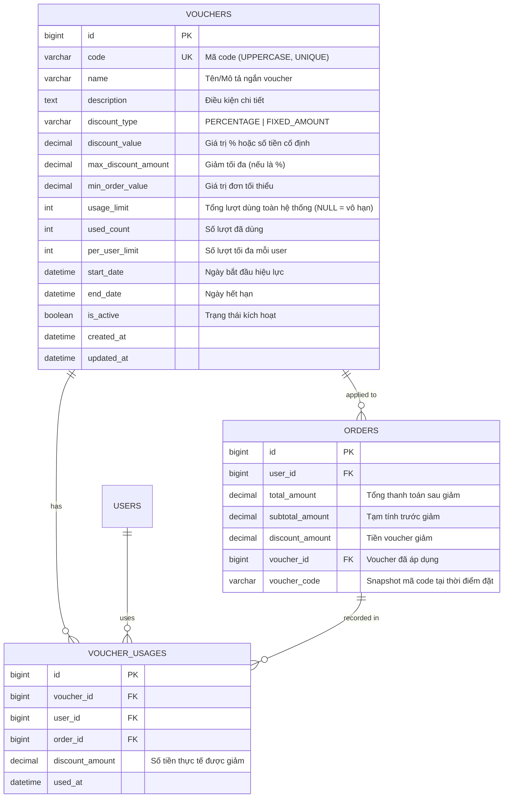

# KẾ HOẠCH TRIỂN KHAI CHI TIẾT - GIAI ĐOẠN 2 (PHASE 2)

## DỰ ÁN: FUNNYSHOP (FULL-STACK)
**Chủ đề:** Thiết kế & Triển khai Hệ thống Mã giảm giá (Voucher Management & Safe Checkout Application)  
**Mã tài liệu:** `docs/PLAN_PHASE_2_VOUCHER_SYSTEM.md`  
**Liên kết Kế hoạch tổng thể:** [PLAN.md](file:///d:/thuc_tap/Thuc_Tap_Ki_IV/PLAN.md) | [PLAN_NEW_FEATURES.md](file:///d:/thuc_tap/Thuc_Tap_Ki_IV/docs/PLAN_NEW_FEATURES.md)  
**Công nghệ:** Spring Boot 3, JPA/Hibernate, MySQL, Pessimistic Locking, React 19, Vite, Tailwind CSS, Lucide Icons  

---

## I. MỤC TIÊU & YÊU CẦU NGHIỆP VỤ (BUSINESS OBJECTIVES)

### 1. Mục tiêu cốt lõi
1. **Quản trị viên (Admin):** Toàn quyền cấu hình, tạo mới, chỉnh sửa, bật/tắt (toggle) và theo dõi số lượt sử dụng của các mã giảm giá trên hệ thống.
2. **Khách hàng (Customer):** Dễ dàng tìm kiếm, chọn lựa từ danh sách mã khả dụng hoặc nhập mã trực tiếp tại bước đặt hàng (Checkout), nhận diện số tiền chiết khấu tức thì và minh bạch.
3. **An toàn giao dịch (Transaction Integrity & Concurrency Safety):**
   - Tuyệt đối tính toán tiền giảm (`discountAmount`) tại Backend; không tin tưởng bất kỳ số tiền nào từ client gửi lên.
   - Áp dụng kỹ thuật **Pessimistic Locking** (`SELECT ... FOR UPDATE`) khi checkout để loại bỏ race condition khi nhiều khách hàng cùng áp dụng mã sắp hết lượt.
   - Ràng buộc giới hạn lượt dùng toàn hệ thống (`usageLimit`) và số lần dùng tối đa trên từng tài khoản người dùng (`perUserLimit`).
   - Lưu vết kiểm toán: Ghi nhận đơn hàng (`orders`) kèm mã voucher, số tiền giảm, giá tạm tính và lưu chi tiết vào bảng lịch sử `voucher_usages`.

---

## II. THIẾT KẾ CƠ SỞ DỮ LIỆU (DATABASE SCHEMA)



### 1. Script DDL (MySQL)

```sql
-- 1. Bảng quản lý Voucher
CREATE TABLE IF NOT EXISTS vouchers (
    id BIGINT AUTO_INCREMENT PRIMARY KEY,
    code VARCHAR(50) NOT NULL UNIQUE,
    name VARCHAR(255) NOT NULL,
    description TEXT,
    discount_type VARCHAR(20) NOT NULL COMMENT 'PERCENTAGE hoặc FIXED_AMOUNT',
    discount_value DECIMAL(12, 2) NOT NULL,
    max_discount_amount DECIMAL(12, 2) NULL COMMENT 'Mức giảm trần khi dùng type PERCENTAGE',
    min_order_value DECIMAL(12, 2) NOT NULL DEFAULT 0.00 COMMENT 'Giá trị đơn tối thiểu',
    usage_limit INT NULL COMMENT 'Tổng số lần mã được dùng (NULL = không giới hạn)',
    used_count INT NOT NULL DEFAULT 0 COMMENT 'Số lần đã dùng thực tế',
    per_user_limit INT NOT NULL DEFAULT 1 COMMENT 'Số lần dùng tối đa của mỗi tài khoản',
    start_date DATETIME NOT NULL,
    end_date DATETIME NOT NULL,
    is_active BOOLEAN NOT NULL DEFAULT TRUE,
    created_at DATETIME DEFAULT CURRENT_TIMESTAMP,
    updated_at DATETIME DEFAULT CURRENT_TIMESTAMP ON UPDATE CURRENT_TIMESTAMP,
    INDEX idx_voucher_code (code),
    INDEX idx_voucher_status_date (is_active, start_date, end_date)
) ENGINE=InnoDB DEFAULT CHARSET=utf8mb4 COLLATE=utf8mb4_unicode_ci;

-- 2. Bảng lịch sử sử dụng Voucher (Audit & Rate Limiting per User)
CREATE TABLE IF NOT EXISTS voucher_usages (
    id BIGINT AUTO_INCREMENT PRIMARY KEY,
    voucher_id BIGINT NOT NULL,
    user_id BIGINT NOT NULL,
    order_id BIGINT NOT NULL,
    discount_amount DECIMAL(12, 2) NOT NULL,
    used_at DATETIME DEFAULT CURRENT_TIMESTAMP,
    CONSTRAINT fk_vu_voucher FOREIGN KEY (voucher_id) REFERENCES vouchers(id) ON DELETE RESTRICT,
    CONSTRAINT fk_vu_user FOREIGN KEY (user_id) REFERENCES users(id) ON DELETE CASCADE,
    CONSTRAINT fk_vu_order FOREIGN KEY (order_id) REFERENCES orders(id) ON DELETE CASCADE,
    INDEX idx_voucher_user (voucher_id, user_id),
    INDEX idx_voucher_order (order_id)
) ENGINE=InnoDB DEFAULT CHARSET=utf8mb4 COLLATE=utf8mb4_unicode_ci;

-- 3. Cập nhật bảng orders để lưu trữ vết chiết khấu
ALTER TABLE orders 
ADD COLUMN IF NOT EXISTS subtotal_amount DECIMAL(12, 2) NULL AFTER total_amount,
ADD COLUMN IF NOT EXISTS discount_amount DECIMAL(12, 2) NOT NULL DEFAULT 0.00 AFTER subtotal_amount,
ADD COLUMN IF NOT EXISTS voucher_id BIGINT NULL AFTER discount_amount,
ADD COLUMN IF NOT EXISTS voucher_code VARCHAR(50) NULL AFTER voucher_id;

-- Khóa ngoại từ orders tới vouchers (SET NULL khi voucher bị xóa)
ALTER TABLE orders 
ADD CONSTRAINT fk_orders_voucher FOREIGN KEY (voucher_id) REFERENCES vouchers(id) ON DELETE SET NULL;
```

---

## III. THIẾT KẾ BACKEND (SPRING BOOT 3 & JPA)

### 1. Phân cấp Cấu trúc Lớp (Package Architecture)
```
backend/src/main/java/com/funnyshop/
├── entity/
│   ├── Voucher.java                   # Entity quản lý mã giảm giá
│   ├── VoucherUsage.java              # Entity lịch sử sử dụng voucher
│   └── Order.java                     # Bổ sung subtotalAmount, discountAmount, voucher
├── enums/
│   └── DiscountType.java              # Enum: PERCENTAGE, FIXED_AMOUNT
├── repository/
│   ├── VoucherRepository.java         # Khóa bi quan (@Lock) & lọc tìm kiếm
│   └── VoucherUsageRepository.java    # Đếm số lần sử dụng theo User ID
├── dto/
│   ├── request/
│   │   ├── VoucherCreateRequest.java  # DTO Admin tạo voucher
│   │   ├── VoucherUpdateRequest.java  # DTO Admin cập nhật voucher
│   │   ├── VoucherApplyRequest.java   # DTO Client gửi mã & giá trị đơn để tính thử
│   │   └── OrderCheckoutRequest.java  # Thêm trường voucherCode
│   └── response/
│       ├── VoucherResponse.java       # Chi tiết voucher trả về Client/Admin
│       ├── VoucherApplyResponse.java  # Kết quả tính tiền giảm thử nghiệm
│       └── OrderResponse.java         # Thêm discountAmount, subtotalAmount, voucherCode
├── service/
│   ├── VoucherService.java            # Interface nghiệp vụ voucher
│   ├── impl/
│   │   ├── VoucherServiceImpl.java    # Xử lý tính toán, validation, admin CRUD
│   │   └── OrderServiceImpl.java      # Tích hợp khóa bi quan & trừ lượt dùng khi checkout
├── controller/
│   ├── VoucherController.java         # Public / Customer APIs
│   └── admin/
│       └── AdminVoucherController.java# Admin Management APIs
└── exception/
    └── VoucherException.java          # Ngoại lệ chuẩn hóa khi voucher không hợp lệ
```

### 2. Thuật toán Tính toán & Ràng buộc Hợp lệ (Validation Rules)

Khi nhận yêu cầu áp dụng voucher với mã `code`, tổng tiền tạm tính `subtotal` và tài khoản `user`:
1. **Mã tồn tại:** `Voucher` phải có trong DB (không phân biệt chữ hoa/thường).
2. **Kích hoạt:** `isActive == true`.
3. **Thời gian hiệu lực:** `now() >= startDate` và `now() <= endDate`.
4. **Đơn tối thiểu:** `subtotal >= minOrderValue`.
5. **Tổng lượt dùng:** Nếu `usageLimit != null` $\rightarrow$ `usedCount < usageLimit`.
6. **Lượt dùng mỗi khách:** Đếm số bản ghi trong `voucher_usages` theo `(voucherId, userId)` $\rightarrow$ phải `< perUserLimit`.
7. **Công thức tính tiền giảm (`discountAmount`):**
   - Nếu `discountType == DiscountType.PERCENTAGE`:
     $$\text{rawDiscount} = \text{subtotal} \times \frac{\text{discountValue}}{100}$$
     Nếu `maxDiscountAmount != null` $\rightarrow$ $\text{discountAmount} = \min(\text{rawDiscount}, \text{maxDiscountAmount})$
     Ngược lại $\rightarrow$ $\text{discountAmount} = \text{rawDiscount}$
   - Nếu `discountType == DiscountType.FIXED_AMOUNT`:
     $$\text{discountAmount} = \min(\text{discountValue}, \text{subtotal})$$
8. **Tổng tiền thanh toán cuối cùng:**
   $$\text{totalAmount} = \max(0, \text{subtotal} - \text{discountAmount})$$

### 3. Cơ chế Khóa Bi quan (Pessimistic Locking) trong Checkout

Để tránh **Race Condition** khi 10 người cùng đặt mua tại giây cuối cùng của một mã chỉ còn 1 lượt dùng:
```java
// Trong VoucherRepository.java
@Lock(LockModeType.PESSIMISTIC_WRITE)
@Query("SELECT v FROM Voucher v WHERE LOWER(v.code) = LOWER(:code)")
Optional<Voucher> findByCodeWithLock(@Param("code") String code);
```
Trong `OrderServiceImpl.createOrder(...)`:
1. Sau khi tính xong `subtotalAmount` từ các `OrderItem`, nếu `request.getVoucherCode()` có giá trị:
2. Gọi `voucherRepository.findByCodeWithLock(code)`: Transaction hiện tại giữ Exclusive Lock trên dòng voucher đó.
3. Chạy lại toàn bộ 6 bước validation bên trên.
4. Tăng `usedCount = voucher.getUsedCount() + 1`.
5. Lưu đơn hàng `order.setSubtotalAmount(subtotal)`, `order.setDiscountAmount(discountAmount)`, `order.setTotalAmount(finalTotal)`.
6. Tạo bản ghi `VoucherUsage` gắn với `savedOrder`, `user`, `voucher`, `discountAmount`.
7. Nếu có lỗi (hết hàng, invalid voucher...), toàn bộ Transaction rollback, lock được giải phóng tự động.

### 4. Danh sách API Endpoints

#### Public / Customer Endpoints:
| Method | Endpoint | Quyền hạn | Mô tả |
|---|---|---|---|
| `GET` | `/api/v1/vouchers/available` | Public | Lấy danh sách voucher đang kích hoạt và còn hạn |
| `POST` | `/api/v1/vouchers/apply` | User / Public | Kiểm tra hợp lệ và xem trước số tiền giảm |

#### Admin Endpoints:
| Method | Endpoint | Quyền hạn | Mô tả |
|---|---|---|---|
| `GET` | `/api/v1/admin/vouchers` | `ROLE_ADMIN` | Danh sách voucher (phân trang, search code/name, filter active) |
| `GET` | `/api/v1/admin/vouchers/{id}` | `ROLE_ADMIN` | Lấy chi tiết 1 voucher |
| `POST` | `/api/v1/admin/vouchers` | `ROLE_ADMIN` | Tạo mới voucher |
| `PUT` | `/api/v1/admin/vouchers/{id}` | `ROLE_ADMIN` | Chỉnh sửa thông tin voucher |
| `PATCH` | `/api/v1/admin/vouchers/{id}/toggle` | `ROLE_ADMIN` | Bật/tắt kích hoạt voucher |
| `DELETE` | `/api/v1/admin/vouchers/{id}` | `ROLE_ADMIN` | Xóa voucher (nếu chưa dùng) hoặc tắt mềm |

---

## IV. THIẾT KẾ FRONTEND (REACT & VITE)

### 1. Phân rã Giao diện & Component

```
frontend/src/
├── api/
│   └── voucher.js                     # axios instance gọi API voucher client & admin
├── components/
│   ├── voucher/
│   │   ├── VoucherSelectorModal.jsx   # Modal popup chọn voucher tiện lợi
│   │   └── VoucherBadge.jsx           # Huy hiệu hiển thị mã voucher đang áp dụng + nút xoá
│   ├── admin/
│   │   └── VoucherFormModal.jsx       # Modal popup tạo/sửa voucher chuẩn form
│   └── layout/
│       └── SidebarAdmin.jsx           # Bổ sung menu "Mã giảm giá"
└── pages/
    ├── Checkout.jsx                   # Tích hợp ô nhập mã, modal chọn, tính discount
    ├── admin/
    │   └── AdminVouchers.jsx          # Trang quản trị danh sách voucher
    └── OrderDetail.jsx                # Hiển thị thông tin mã giảm và tiền giảm của đơn
```

### 2. Giao diện Người dùng tại Checkout (`Checkout.jsx`)
- Khối Voucher được đặt trang trọng ngay phía trên tổng tiền:
  ```text
  +-------------------------------------------------------------------+
  | Mã giảm giá                                                       |
  | [ Nhập mã voucher...        ] [ Áp dụng ]  [ 🎟️ Chọn mã có sẵn ]   |
  |                                                                   |
  | (Đã áp dụng) [🎟️ FUNNY50K - Giảm 50.000 ₫] [ ✕ Huỷ ]            |
  +-------------------------------------------------------------------+
  | Tạm tính:                                               500.000 ₫ |
  | Giảm giá Voucher:                                       -50.000 ₫ |
  | Phí vận chuyển:                                             Miễn phí |
  | ----------------------------------------------------------------- |
  | Tổng thanh toán:                                        450.000 ₫ |
  +-------------------------------------------------------------------+
  ```
- **Modal Chọn Mã (`VoucherSelectorModal.jsx`):**
  - Hiển thị danh sách thẻ voucher đẹp mắt (Ticket card UI).
  - Có thanh tiến trình hoặc ghi chú rõ: *"Đơn tối thiểu 300.000 ₫ - Bạn còn thiếu 50.000 ₫ để dùng mã này"* (nếu chưa đạt điều kiện).
  - Nhấp "Áp dụng ngay" sẽ tự điền và kích hoạt mã vào màn hình Checkout.

### 3. Giao diện Quản trị (`AdminVouchers.jsx`)
- Bảng quản trị hiển thị các cột:
  - **Mã Code:** Badge in hoa (VD: `SUMMER2026`).
  - **Tên & Điều kiện:** Tên chương trình, đơn tối thiểu, mức giảm tối đa.
  - **Loại & Mức giảm:** `%` (kèm trần) hoặc Số tiền cố định.
  - **Tiến độ sử dụng:** Thanh Progress Bar `usedCount / usageLimit` trực quan.
  - **Thời hạn:** Ngày bắt đầu $\rightarrow$ Ngày hết hạn.
  - **Trạng thái:** Switch toggle bật/tắt xanh/xám tức thì.
  - **Thao tác:** Nút Xem/Sửa, Nút Xóa.
- Modal tạo/sửa hỗ trợ kiểm tra regex mã code (chỉ chấp nhận ký tự chữ cái và số, tự động chuyển hoa).

---

## V. KỊCH BẢN KIỂM THỬ (TEST PLAN & ACCEPTANCE CRITERIA)

| Mã kiểm thử | Tình huống thử nghiệm | Kết quả mong đợi |
|---|---|---|
| **TC-V01** | Admin tạo voucher PERCENTAGE 10%, max 50.000 ₫, min 200.000 ₫ | Tạo thành công, lưu đúng DB và hiển thị trên bảng quản trị |
| **TC-V02** | Admin tạo voucher FIXED_AMOUNT 30.000 ₫, min 100.000 ₫ | Tạo thành công, giá trị giảm cố định 30.000 ₫ |
| **TC-V03** | Khách áp dụng mã khi đơn hàng 150.000 ₫ (< 200.000 ₫ min) | Báo lỗi: *"Đơn hàng chưa đạt giá trị tối thiểu 200.000 ₫"* |
| **TC-V04** | Khách áp dụng mã đã hết hạn (`endDate < now`) | Báo lỗi: *"Mã giảm giá đã hết hạn sử dụng"* |
| **TC-V05** | Khách áp dụng mã có `isActive = false` | Báo lỗi: *"Mã giảm giá không tồn tại hoặc đã ngừng hoạt động"* |
| **TC-V06** | Mã có `maxDiscountAmount = 50.000 ₫`, đơn hàng 1.000.000 ₫ giảm 10% | Số tiền giảm đúng bằng 50.000 ₫ (chặn trần), tổng thanh toán 950.000 ₫ |
| **TC-V07** | Khách đã sử dụng mã 1 lần, đặt lại lần 2 với mã có `perUserLimit = 1` | Báo lỗi: *"Bạn đã sử dụng hết lượt cho mã giảm giá này"* |
| **TC-V08** | Concurrency: Mã còn 1 lượt, 2 luồng đồng thời gọi checkout | 1 đơn thành công, 1 đơn thất bại với lỗi hết lượt dùng; `usedCount` không vượt quá limit |
| **TC-V09** | Đặt hàng thành công có mã voucher | Bảng `orders` lưu đúng `subtotal_amount`, `discount_amount`, `voucher_code`; tạo 1 dòng trong `voucher_usages` |
| **TC-V10** | Admin bật/tắt (toggle) trạng thái voucher | Trạng thái cập nhật tức thời; mã bị tắt không thể áp dụng tại checkout |

---

## VI. KẾ HOẠCH TRIỂN KHAI THEO TỪNG BƯỚC (STEP-BY-STEP CHECKLIST)

### Bước 1: Backend Database & Entities
- [ ] 1.1. Tạo entity `Voucher.java` và enum `DiscountType.java`.
- [ ] 1.2. Tạo entity `VoucherUsage.java`.
- [ ] 1.3. Cập nhật entity `Order.java` bổ sung `subtotalAmount`, `discountAmount`, `voucher`, `voucherCode`.
- [ ] 1.4. Tạo migration file / cập nhật `schema.sql`.

### Bước 2: Backend Repositories & DTOs
- [ ] 2.1. Tạo `VoucherRepository.java` với query `@Lock(LockModeType.PESSIMISTIC_WRITE)`.
- [ ] 2.2. Tạo `VoucherUsageRepository.java`.
- [ ] 2.3. Tạo các DTO Request: `VoucherCreateRequest`, `VoucherUpdateRequest`, `VoucherApplyRequest`.
- [ ] 2.4. Cập nhật `OrderCheckoutRequest` thêm trường `voucherCode`.
- [ ] 2.5. Tạo DTO Response: `VoucherResponse`, `VoucherApplyResponse`.
- [ ] 2.6. Cập nhật `OrderResponse` thêm thông tin voucher.

### Bước 3: Backend Service Layer & Checkout Integration
- [ ] 3.1. Viết `VoucherService.java` & triển khai `VoucherServiceImpl.java`.
- [ ] 3.2. Cập nhật `OrderServiceImpl.java`: Tích hợp logic khóa voucher, kiểm tra điều kiện, tính toán trừ tiền và ghi nhận `VoucherUsage` trong transaction.
- [ ] 3.3. Cập nhật logic huỷ đơn hàng: Nếu đơn có voucher bị huỷ, xem xét hoàn lại lượt dùng nếu cần.

### Bước 4: Backend Controllers & Security
- [ ] 4.1. Tạo `VoucherController.java` cho client (`/available`, `/apply`).
- [ ] 4.2. Tạo `AdminVoucherController.java` cho admin (CRUD, toggle).
- [ ] 4.3. Cập nhật `SecurityConfig.java` cho phép truy cập hợp lệ.

### Bước 5: Frontend API & Admin Management UI
- [ ] 5.1. Tạo `frontend/src/api/voucher.js`.
- [ ] 5.2. Tạo component `frontend/src/components/admin/VoucherFormModal.jsx`.
- [ ] 5.3. Tạo trang `frontend/src/pages/admin/AdminVouchers.jsx`.
- [ ] 5.4. Cập nhật `SidebarAdmin.jsx` thêm tab "Mã giảm giá".
- [ ] 5.5. Cập nhật `App.jsx` cấu hình route `/admin/vouchers`.

### Bước 6: Frontend Storefront Checkout Integration
- [ ] 6.1. Tạo component `frontend/src/components/voucher/VoucherSelectorModal.jsx`.
- [ ] 6.2. Cập nhật `frontend/src/pages/Checkout.jsx` tích hợp chọn voucher, xem trước giảm giá và gửi `voucherCode` khi tạo đơn.
- [ ] 6.3. Cập nhật `frontend/src/pages/OrderDetail.jsx` hiển thị chi tiết tiền giảm voucher.

### Bước 7: Kiểm thử, Tối ưu & Đóng gói
- [ ] 7.1. Chạy Backend unit/integration tests hoặc test script.
- [ ] 7.2. Chạy `npm run lint` & `npm run build` frontend.
- [ ] 7.3. Cập nhật trạng thái hoàn thành Phase 2 trong `PLAN.md`.

