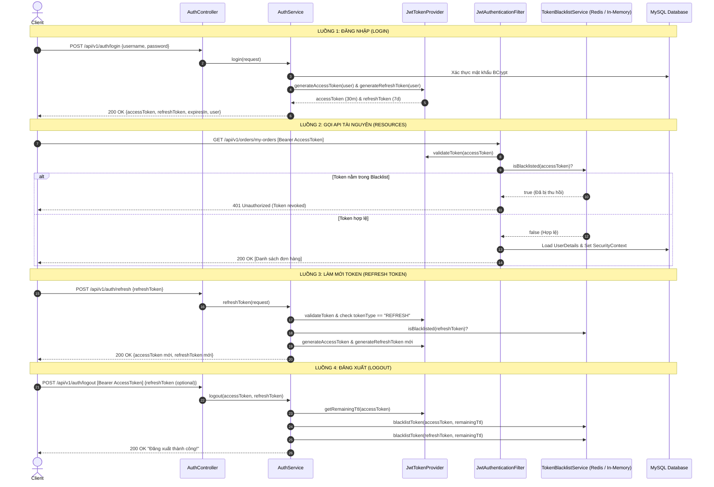

# KẾ HOẠCH TRIỂN KHAI: REFRESH TOKEN, API ĐĂNG XUẤT & REDIS TOKEN BLACKLIST

> **Dự án:** FunnyShop E-Commerce Backend  
> **Module:** Authentication & Security Enhancement  
> **Kiến trúc áp dụng:** Interface + Switch Config (`@ConditionalOnProperty`)  
> **Mục tiêu:** 
> 1. Triển khai cơ chế Refresh Token (Access Token sống ngắn, Refresh Token sống dài).
> 2. Xây dựng dịch vụ Token Blacklist với 2 chế độ: Redis (Production/Staging) và In-Memory (Local Dev) chuyển đổi chỉ bằng 1 dòng cấu hình `application.yml`.
> 3. Triển khai API Đăng xuất (`POST /api/v1/auth/logout`) thu hồi token và chặn tức thì tại `JwtAuthenticationFilter`.

---

## I. ĐÁNH GIÁ HIỆN TRẠNG & BÀI TOÁN KỸ THUẬT

### 1. Hiện trạng FunnyShop
- Hiện tại, `JwtTokenProvider` chỉ sinh ra duy nhất một Access Token với thời hạn sống dài: **24 giờ** (`jwt.expiration: 86400000`).
- Chưa có cơ chế **Refresh Token**: Nếu token hết hạn hoặc thời hạn token quá ngắn, người dùng buộc phải đăng nhập lại từ đầu (ảnh hưởng UX). Nếu để thời hạn quá dài (24h) mà không có cơ chế thu hồi, nếu lộ token thì kẻ gian có toàn quyền truy cập trong suốt 24h.
- Chưa có **API Đăng xuất (Logout)** phía Server: Frontend hiện tại chỉ tự xóa token trong `localStorage` (`authStore.logout()`). Ở phía Server, token cũ vẫn hoàn toàn hợp lệ cho đến khi hết hạn tự nhiên.

### 2. Yêu cầu & Giải pháp thiết kế
1. **Rút ngắn tuổi thọ Access Token** (ví dụ: 30 phút) và bổ sung **Refresh Token** (7 ngày).
2. **Thu hồi Token ngay lập tức khi Logout**:
   - Khi người dùng ấn Đăng xuất, Access Token và Refresh Token sẽ được lưu vào **Danh sách đen (Blacklist)**.
   - Tại `JwtAuthenticationFilter`, mọi request mang token nằm trong Blacklist sẽ bị **từ chối ngay lập tức (401 Unauthorized)** dù token đó chưa hết hạn theo chữ ký JWT.
3. **Mô hình Interface + Switch Config (Linh hoạt & Tối ưu)**:
   - Khi chạy Local Dev: Không bắt buộc mọi lập trình viên phải cài đặt/bật Redis server, hệ thống tự động chạy chế độ `in-memory` (dùng `ConcurrentHashMap` lưu trong RAM, có cơ chế tự dọn dẹp TTL).
   - Khi chạy Staging/Production/Docker: Chuyển cấu hình `provider: redis`, hệ thống lập tức sử dụng Redis với tính năng TTL tự động và hỗ trợ cụm phân tán (Multi-instance/Cluster).

---

## II. THIẾT KẾ KIẾN TRÚC HỆ THỐNG

### 1. Sơ đồ luồng xác thực, Refresh và Logout



---

## III. CHI TIẾT CÁC THÀNH PHẦN KỸ THUẬT

### 1. Cấu hình Maven/Gradle Dependencies (`backend/build.gradle`)
Bổ sung starter Redis:
```groovy
dependencies {
    // Spring Data Redis (dùng cho Redis Token Blacklist)
    implementation 'org.springframework.boot:spring-boot-starter-data-redis'
    ...
}
```

### 2. Cấu hình Switch Config trong `application.yml`
```yaml
jwt:
  secret: 404E635266556A586E3272357538782F413F4428472B4B6250655368566D5971
  access-expiration: 1800000     # 30 phút (30 * 60 * 1000 ms)
  refresh-expiration: 604800000  # 7 ngày (7 * 24 * 60 * 60 * 1000 ms)

app:
  security:
    token-blacklist:
      # Chế độ blacklist: 'in-memory' (mặc định khi dev) hoặc 'redis' (production/staging)
      provider: in-memory

spring:
  data:
    redis:
      host: ${REDIS_HOST:localhost}
      port: ${REDIS_PORT:6379}
      timeout: 3000ms
```

### 3. Thiết kế Interface & Implementations cho Token Blacklist

#### A. Interface `TokenBlacklistService.java`
```java
package com.funnyshop.security.blacklist;

public interface TokenBlacklistService {
    /**
     * Đưa token vào danh sách đen với thời gian sống TTL còn lại của token
     * @param token Chuỗi JWT
     * @param ttlInMillis Thời gian sống còn lại (mili-giây)
     */
    void blacklistToken(String token, long ttlInMillis);

    /**
     * Kiểm tra xem token có nằm trong danh sách đen không
     */
    boolean isBlacklisted(String token);
}
```

#### B. Implementation 1: `InMemoryTokenBlacklistService.java` (Local Dev)
- Sử dụng `ConcurrentHashMap<String, Long>` (lưu trữ token -> thời điểm hết hạn `expireAtMillis`).
- Tích hợp `@Scheduled(fixedRate = 600000)` để quét dọn (evict) các token đã quá hạn trong RAM.
- Điều kiện kích hoạt:
  ```java
  @Service
  @ConditionalOnProperty(name = "app.security.token-blacklist.provider", havingValue = "in-memory", matchIfMissing = true)
  public class InMemoryTokenBlacklistService implements TokenBlacklistService { ... }
  ```

#### C. Implementation 2: `RedisTokenBlacklistService.java` (Redis Staging / Production)
- Sử dụng `StringRedisTemplate`.
- Key format: `blacklist:token:<token>`.
- Lưu key kèm TTL: `redisTemplate.opsForValue().set(key, "revoked", ttlInMillis, TimeUnit.MILLISECONDS)`.
- Redis tự động xóa key khi hết hạn TTL, không tốn dung lượng RAM lưu trữ rác.
- Điều kiện kích hoạt:
  ```java
  @Service
  @ConditionalOnProperty(name = "app.security.token-blacklist.provider", havingValue = "redis")
  public class RedisTokenBlacklistService implements TokenBlacklistService { ... }
  ```

---

### 4. Nâng Cấp `JwtTokenProvider.java`
Bổ sung các phương thức chuyên biệt cho Refresh Token và tính TTL:
1. `generateAccessToken(UserDetails userDetails, Long userId, String role)`: Tạo token ngắn hạn với claim `type: "ACCESS"`.
2. `generateRefreshToken(UserDetails userDetails, Long userId)`: Tạo token dài hạn với claim `type: "REFRESH"`.
3. `isRefreshToken(String token)`: Kiểm tra claim `type == "REFRESH"`.
4. `getRemainingExpirationMillis(String token)`: Lấy thời gian sống còn lại:
   ```java
   public long getRemainingExpirationMillis(String token) {
       Date expiration = getClaimFromToken(token, Claims::getExpiration);
       return Math.max(0, expiration.getTime() - System.currentTimeMillis());
   }
   ```

---

### 5. Thiết kế DTOs Mới

#### A. `RefreshTokenRequest.java`
```java
package com.funnyshop.dto.request;

import jakarta.validation.constraints.NotBlank;
import lombok.AllArgsConstructor;
import lombok.Builder;
import lombok.Data;
import lombok.NoArgsConstructor;

@Data
@Builder
@NoArgsConstructor
@AllArgsConstructor
public class RefreshTokenRequest {
    @NotBlank(message = "Refresh token không được để trống")
    private String refreshToken;
}
```

#### B. `LogoutRequest.java` (Tùy chọn body kèm refreshToken)
```java
package com.funnyshop.dto.request;

import lombok.AllArgsConstructor;
import lombok.Builder;
import lombok.Data;
import lombok.NoArgsConstructor;

@Data
@Builder
@NoArgsConstructor
@AllArgsConstructor
public class LogoutRequest {
    private String refreshToken;
}
```

#### C. Cập nhật `AuthResponse.java`
Bổ sung trường `refreshToken`:
```java
public class AuthResponse {
    private String accessToken;
    private String refreshToken; // Thêm mới
    private String tokenType;
    private Long expiresIn;
    private UserResponse user;
}
```

---

### 6. Cập nhật `AuthService` & `AuthServiceImpl`
Bổ sung 2 phương thức nghiệp vụ:
1. `AuthResponse refreshToken(RefreshTokenRequest request)`:
   - Validate chữ ký và định dạng `refreshToken`.
   - Kiểm tra `!jwtTokenProvider.isRefreshToken(refreshToken)` -> quăng ngoại lệ `AppException("Token không đúng loại Refresh Token", HttpStatus.BAD_REQUEST)`.
   - Kiểm tra `tokenBlacklistService.isBlacklisted(refreshToken)` -> quăng ngoại lệ `AppException("Refresh Token đã bị thu hồi", HttpStatus.UNAUTHORIZED)`.
   - Lấy username -> nạp `User` từ database -> sinh `accessToken` mới (kèm `refreshToken` mới theo cơ chế Rotation).
2. `void logout(String accessToken, String refreshToken)`:
   - Nếu `accessToken != null`:
     - Lấy `ttl = jwtTokenProvider.getRemainingExpirationMillis(accessToken)`.
     - Nếu `ttl > 0`: `tokenBlacklistService.blacklistToken(accessToken, ttl)`.
   - Nếu `refreshToken != null`:
     - Lấy `ttl = jwtTokenProvider.getRemainingExpirationMillis(refreshToken)`.
     - Nếu `ttl > 0`: `tokenBlacklistService.blacklistToken(refreshToken, ttl)`.

---

### 7. Cập nhật `AuthController.java`
Thêm 2 endpoints mới:
- `POST /api/v1/auth/refresh`: Nhận `RefreshTokenRequest`, trả về `AuthResponse` mới.
- `POST /api/v1/auth/logout`: Nhận Bearer token từ header và body `LogoutRequest` (optional), gọi service thu hồi token.

---

### 8. Tích hợp Chặn Blacklist tại `JwtAuthenticationFilter.java`
Trong phương thức `doFilterInternal`:
```java
if (jwt != null && jwtTokenProvider.validateToken(jwt)) {
    if (tokenBlacklistService.isBlacklisted(jwt)) {
        log.warn("Truy cập bị từ chối: Token đã bị thu hồi trong Blacklist");
        filterChain.doFilter(request, response);
        return;
    }
    // Tiếp tục xác thực nạp UserDetails...
}
```

---

### 9. Cập nhật Phân quyền tại `SecurityConfig.java`
- Thêm cấu hình `@EnableScheduling` để hỗ trợ dọn rác bộ nhớ cho `InMemoryTokenBlacklistService`.
- Đảm bảo `/api/v1/auth/**` (bao gồm `/login`, `/register`, `/refresh`, `/logout`) nằm trong danh sách `PUBLIC_ENDPOINTS` để client có thể gọi refresh token khi access token đã hết hạn, và gọi logout an toàn.

---

## IV. MA TRẬN KIỂM THỬ (TEST PLAN)

### Unit Tests

| STT | Class Test | Kịch bản kiểm thử | Kết quả mong đợi | Trạng thái |
| :--- | :--- | :--- | :--- | :---: |
| 1 | `InMemoryTokenBlacklistServiceTest` | Thêm token với TTL 100ms, kiểm tra trước khi hết hạn | `isBlacklisted() = true` | ✅ PASS |
| 2 | `InMemoryTokenBlacklistServiceTest` | Kiểm tra token không tồn tại trong blacklist | `isBlacklisted() = false` | ✅ PASS |
| 3 | `InMemoryTokenBlacklistServiceTest` | Thêm token với TTL đã hết (expired), kiểm tra lazy eviction | `isBlacklisted() = false` | ✅ PASS |
| 4 | `InMemoryTokenBlacklistServiceTest` | Gọi `cleanupExpiredTokens()` xóa token quá hạn | Map trống sau cleanup | ✅ PASS |
| 5 | `RedisTokenBlacklistServiceTest` | Mock `StringRedisTemplate`, kiểm tra `blacklistToken()` gọi đúng TTL | `set()` được gọi 1 lần | ✅ PASS |
| 6 | `RedisTokenBlacklistServiceTest` | `isBlacklisted()` khi Redis trả về key tồn tại | `true` | ✅ PASS |
| 7 | `RedisTokenBlacklistServiceTest` | `isBlacklisted()` khi Redis không có key | `false` | ✅ PASS |
| 8 | `AuthServiceImplTest` | Đăng ký tài khoản mới thành công | `UserResponse` hợp lệ | ✅ PASS |
| 9 | `AuthServiceImplTest` | Đăng ký trùng username → ném exception | `ResourceAlreadyExistsException` | ✅ PASS |
| 10 | `AuthServiceImplTest` | Đăng nhập thành công → sinh cả `accessToken` + `refreshToken` | `AuthResponse` chứa 2 token | ✅ PASS |
| 11 | `AuthServiceImplTest` | `refreshToken()` với refresh token hợp lệ → Token Rotation | Cặp token mới, token cũ bị blacklist | ✅ PASS |
| 12 | `AuthServiceImplTest` | `refreshToken()` với access token (sai loại) → 400 | `AppException BAD_REQUEST` | ✅ PASS |
| 13 | `AuthServiceImplTest` | `refreshToken()` với token đã bị blacklist → 401 | `AppException UNAUTHORIZED` | ✅ PASS |
| 14 | `AuthServiceImplTest` | `logout()` → đưa cả 2 token vào blacklist | `blacklistToken()` được gọi 2 lần | ✅ PASS |
| 15 | `AuthControllerTest` | `POST /api/v1/auth/register` → 201 Created | `code: 201`, `data.username` hợp lệ | ✅ PASS |
| 16 | `AuthControllerTest` | `POST /api/v1/auth/login` → 200 OK trả cả 2 token | `accessToken` và `refreshToken` có mặt | ✅ PASS |
| 17 | `AuthControllerTest` | `POST /api/v1/auth/refresh` → 200 OK | `message: "Làm mới token thành công!"` | ✅ PASS |
| 18 | `AuthControllerTest` | `POST /api/v1/auth/logout` → 200 OK | `message: "Đăng xuất thành công, token đã bị thu hồi!"` | ✅ PASS |

### Integration Tests E2E

| STT | Class Test | Kịch bản E2E | Kết quả mong đợi | Trạng thái |
| :--- | :--- | :--- | :--- | :---: |
| 1 | `AuthFlowIntegrationTest` | Login → Response chứa cả `accessToken` và `refreshToken` | `code: 200`, 2 token không null | ✅ PASS |
| 2 | `AuthFlowIntegrationTest` | Refresh → Token mới hoạt động bình thường gọi API | Nhận token mới → `GET /my-orders` → 200 OK | ✅ PASS |
| 3 | `AuthFlowIntegrationTest` | Logout → Dùng lại `accessToken` cũ → bị chặn | `GET /my-orders` → 401 Unauthorized | ✅ PASS |
| 4 | `AuthFlowIntegrationTest` | Token Rotation: Refresh Token cũ bị thu hồi sau khi refresh | Dùng lại `refreshToken` cũ → 401 Unauthorized | ✅ PASS |
| 5 | `AuthFlowIntegrationTest` | Gửi Access Token vào `/refresh` (sai loại) → bị từ chối | 400 Bad Request | ✅ PASS |

---

## V. CÁC FILE ĐÃ TRIỂN KHAI

| File | Mô tả | Trạng thái |
| :--- | :--- | :---: |
| `backend/build.gradle` | Thêm `spring-boot-starter-data-redis` | ✅ Done |
| `backend/src/main/resources/application.yml` | Cấu hình `jwt.*`, `token-blacklist.provider`, `spring.data.redis.*` | ✅ Done |
| `docker-compose.yml` | Thêm service Redis 7.2-alpine, env `APP_SECURITY_TOKEN_BLACKLIST_PROVIDER: redis` | ✅ Done |
| `FunnyShopApplication.java` | Thêm `@EnableScheduling` | ✅ Done |
| `security/blacklist/TokenBlacklistService.java` | Interface định nghĩa `blacklistToken()` + `isBlacklisted()` | ✅ Done |
| `security/blacklist/InMemoryTokenBlacklistService.java` | Impl dùng `ConcurrentHashMap`, `@ConditionalOnProperty(matchIfMissing=true)` | ✅ Done |
| `security/blacklist/RedisTokenBlacklistService.java` | Impl dùng `StringRedisTemplate`, `@ConditionalOnProperty(havingValue="redis")` | ✅ Done |
| `security/JwtTokenProvider.java` | Bổ sung `generateAccessToken`, `generateRefreshToken`, `isRefreshToken`, `getRemainingExpirationMillis` | ✅ Done |
| `dto/request/RefreshTokenRequest.java` | DTO với `@NotBlank refreshToken` | ✅ Done |
| `dto/request/LogoutRequest.java` | DTO với `refreshToken` optional | ✅ Done |
| `dto/response/AuthResponse.java` | Bổ sung field `refreshToken` | ✅ Done |
| `service/AuthService.java` | Thêm interface `refreshToken()` + `logout()` | ✅ Done |
| `service/impl/AuthServiceImpl.java` | Triển khai đầy đủ Token Rotation + Blacklist | ✅ Done |
| `controller/AuthController.java` | Thêm `POST /api/v1/auth/refresh` + `POST /api/v1/auth/logout` | ✅ Done |
| `security/JwtAuthenticationFilter.java` | Kiểm tra `isBlacklisted()` ngay sau `validateToken()` | ✅ Done |

---

## VI. KẾ HOẠCH BƯỚC ĐI (ACTION PLAN)

- [x] **Bước 1:** Thêm dependency Redis vào `backend/build.gradle` và cập nhật cấu hình `application.yml`.
- [x] **Bước 2:** Xây dựng Interface `TokenBlacklistService` và 2 lớp triển khai `InMemoryTokenBlacklistService` + `RedisTokenBlacklistService`.
- [x] **Bước 3:** Nâng cấp `JwtTokenProvider` hỗ trợ Refresh Token claims và tính remaining TTL.
- [x] **Bước 4:** Tạo DTOs `RefreshTokenRequest`, `LogoutRequest` và cập nhật `AuthResponse`.
- [x] **Bước 5:** Bổ sung nghiệp vụ `refreshToken` và `logout` trong `AuthService` & `AuthServiceImpl`.
- [x] **Bước 6:** Thêm endpoint trong `AuthController` và tích hợp kiểm tra blacklist trong `JwtAuthenticationFilter`.
- [x] **Bước 7:** Viết Unit Test (18 cases) và Integration Test E2E (5 cases) — toàn bộ PASS.

